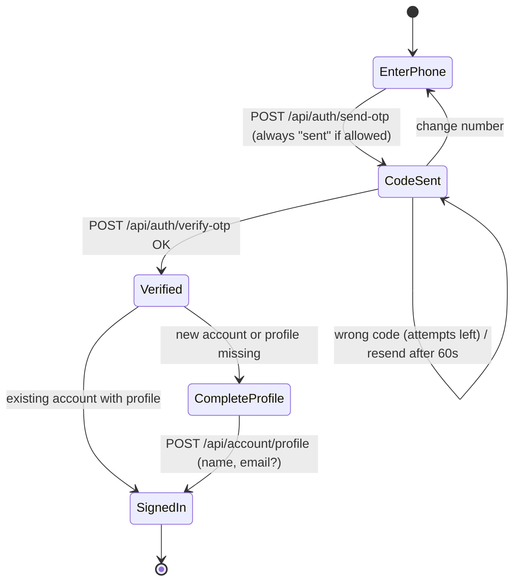
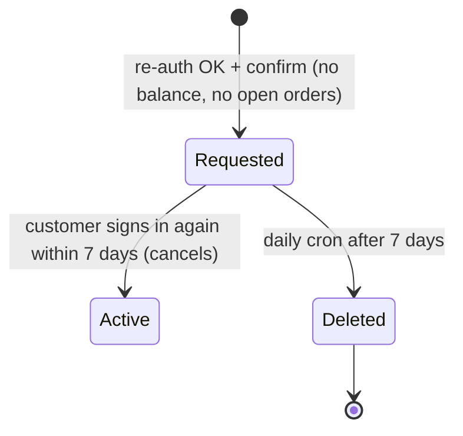

# tlbaty Customer Authentication: Architecture and Engineering Plan

| Field | Value |
|---|---|
| Scope | Customer sign-in, sign-up, sign-out, account deletion, recovery; admin-selected login method |
| Input | `tlbaty-customer-auth-request.md` (clarified request) |
| Baseline | `main` at `3b55afc` |
| Evidence tags | **[V]** verified in source (file named). **[A]** assumption or default, needs confirmation. **[S]** external source, listed in §12. |
| Decisions applied | The defaults in §11 are used throughout. Changing one changes only the sections it names. |

---

## 0. Summary

1. **One admin setting decides how customers prove their phone.** Six options, each a separate module behind one interface. Switching never signs anyone out.
2. **Verify first, then profile.** For every code-based or chat-based method, the customer enters a phone number and proves it *before* the system says whether an account exists. New customers then fill in the three-part name and optional email. This gives "smart switching" between sign-in and sign-up without revealing which numbers are registered.
3. **PUK mode is a separate path** with phone + password as the daily login. An admin-issued PUK is used only for first setup and recovery. It needs no server, no provider and no per-message cost.
4. **Account deletion is an anonymising soft delete**, not a row delete. The wallet ledger cannot be deleted or edited, and its foreign keys are `restrict` [V], so the customer row must stay as a tombstone. The phone number is freed.
5. **Two existing defects must be fixed first (Phase 0)**, because the new features make them worse:
   - Old guest orders are shown to whoever owns the matching phone number. After deletion and number reuse, that becomes a privacy leak (§2.2).
   - There is no account deletion today, which app stores require if the store ever ships an app (§1.3).

---

## 1. Competitor and Standards Study

### 1.1 What leading stores do (general practice)

The patterns below are the common practice of large regional and global stores (noon, Amazon, SHEIN, Salla and Zid stores, Shopify's new customer accounts). They are stated as industry practice, not as verified details of any single store. Live flows change often; confirm against the current apps before copying copy text.

| Practice | What it looks like | Adopt? |
|---|---|---|
| **Identifier-first entry** | One screen asks for the phone (or email). The next screen depends on the account: a code, a password, or "create account". | **Yes.** §5.1 |
| **Passwordless by default** | A one-time code by SMS, WhatsApp or email is the main sign-in. Passwords are optional or absent. | **Yes**, for methods 1–5. Passwords only in PUK mode. |
| **Profile after verification** | Name and email are asked after the phone is proven, often on one short screen. | **Yes.** Avoids enumeration and abandoned half-sign-ups. |
| **Keep the number across screens** | Moving between sign-in and sign-up never makes the customer retype the number. | **Yes.** |
| **Self-service deletion in the account page**, with re-authentication and a warning about orders and balances | Usually a grace period during which signing in cancels it. | **Yes**, with a 7-day grace period [A]. §5.5 |
| **Orders survive deletion**, detached and later anonymised | Required for accounting, returns and tax. | **Yes.** Orders already use `ON DELETE SET NULL` [V]. |
| **Sign out of all devices** | Usually under security settings. | Already built [V]. |

### 1.2 WhatsApp Business Platform (method 1)

- **Template category.** Codes must be sent with an **authentication** template. Meta detects code content in other categories and reclassifies or rejects it. [S1, S2]
- **Button types.**
  - *Copy code*: a button that copies the code, sent through the Cloud API. It needs no special approval.
  - *One-tap* and *zero-tap*: Android autofill. Zero-tap requires accepting extra terms. [S2, S3]
  - **Use copy code** first: it works on every device and needs no Android app.
- **Pricing.** Since 1 July 2025, Meta charges per delivered template message, by category and recipient country. One vendor estimate puts authentication at about $0.011 per message, against about $0.088 for an SMS code. [S1] This is a third-party estimate: check Meta's official rate card for Yemen and Saudi Arabia before budgeting.
- **Consequence.** Method 1 is the only WhatsApp option with no ban risk, because it is the official channel. It costs money per code and needs a Meta business account.

### 1.3 App-store rules (if a mobile app is ever published)

- **Apple** (guideline 5.1.1(v)): any app that lets users create an account must let them **start account deletion inside the app**. [S4]
- **Google Play** also requires **a public web link** where users can request deletion without reinstalling the app. Deactivation or freezing alone does not count as deletion. [S5]
- **Plan impact:** deletion lives in `/account` (works inside a web-view app) **and** at a public page `/account/delete` that explains the steps and starts the same flow after sign-in.

### 1.4 Password guidance (PUK mode only)

From NIST SP 800-63B revision 4 (July 2025), as summarised by secondary sources [S6]:

- **Length:** 15 characters minimum when a password is the only factor; at least 64 accepted.
- **Screening:** check new passwords against a list of common or breached passwords.
- **Attempts:** limit failed attempts.
- **No composition rules** (forced symbols and the like), **no forced rotation**, **no security questions.**

**Our deviation [A]:** a 15-character minimum is harsh for a phone-first Arabic store. The plan uses **10 characters minimum** plus a blocklist and strict throttling. The phone is also bound by an admin-issued PUK, so this is a single factor with compensating controls. The minimum is one constant, so it can be raised to 15 later without a migration.

---

## 2. Current State

### 2.1 What exists

| Area | State |
|---|---|
| **Customer row** | `customers`: phone (unique), `status` (`active`/`blocked`), `verified`, marketing opt-in, `last_login_at`. **No name, email or password.** [V] `lib/db/store/customers.ts` |
| **Delivery channels** | `whatsapp`, `sms`, `whatsapp_sms` (fallback on failure). Chosen in settings, read from the database without cache. [V] `lib/otp/channel.ts`, `lib/otp/provider.ts` |
| **Provider pattern** | `OtpProvider { name, send() }`. Adding a provider means adding a file. [V] |
| **Codes** | 6 digits, 300 s expiry, 60 s resend, 5 attempts. Hashed with salt. [V] `lib/otp/config.ts`, `lib/otp/hash.ts` |
| **Rate limits** | Database-backed: 5 sends per phone per hour, 15 per IP, 10 failed verifies per phone per 15 minutes, 20 chat challenges per IP. [V] `lib/otp/rate-limit.ts` |
| **Sessions** | Server-side, token stored as a hash, 30 days, revoke flag, IP and user agent. Cookie `tajline_session`. [V] `lib/otp/session.ts` |
| **Chat login** | The browser gets a short token and a `wa.me` link. The worker claims it with the sender's number and **replies with a code**, which the same browser (bound by a hashed cookie secret) then types in. [V] `lib/otp/chat-login.ts`, `login_challenges` |
| **WhatsApp Web worker** | `whatsapp-web.js` with `LocalAuth`, bound to `127.0.0.1` by default, bearer token of at least 16 characters with constant-time compare, country allow list, per-recipient cooldown, hourly and daily caps, circuit breaker, single send queue. [V] `worker/whatsapp/server.mjs`, `handler.mjs` |
| **Shared login step** | `completeLogin()` finds or creates the customer, refuses blocked accounts, opens the session and audits. Every method must end here. [V] `lib/otp/login.ts` |
| **Audit** | `auth_events` with an enum of event types. [V] |
| **Panel password hashing** | `scrypt` from `node:crypto`, format `salt:hash`. [V] `lib/manage-users.ts` |
| **Daily cleanup cron** | Exists. [V] `app/api/cron/cleanup/route.ts` |

### 2.2 Defects the new work must fix first

| # | Finding | Why it matters |
|---|---|---|
| D1 | **Phone-matched legacy orders.** A signed-in customer sees orders that have no account but match their phone. [V] `lib/otp/customer-orders.ts` | After a deletion frees a number (or the operator recycles it), the new holder sees the previous person's orders, names and addresses. Deleting an account today would also set `orders.customer_id` to null [V], turning that customer's own orders into "legacy" orders matched by phone. |
| D2 | **Wallet foreign keys are `restrict`, and the ledger is append-only by trigger.** [V] `lib/db/store/wallet.ts` | A plain `DELETE FROM customers` fails for anyone who ever had a wallet. Deletion must be an anonymising soft delete. |
| D3 | **No deletion at all.** | Store policy requirement; app stores require it if an app is published (§1.3). |

---

## 3. Target Architecture

### 3.1 Two separate ideas: method and channel

- **Login method:** how the customer proves the phone. Exactly one is active (`site_settings.login_method`).
- **Delivery channel:** how a code travels (WhatsApp Cloud, WhatsApp Web, SMS). Used by the code-based methods only.

| Key | Admin label (Arabic UI) | Kind | Channels | Daily login |
|---|---|---|---|---|
| `wa_cloud` | واتساب الرسمي (WhatsApp Business API) | code | Cloud API | phone + code |
| `wa_web` | واتساب عبر الخادم (whatsapp-web.js) | code | worker | phone + code |
| `sms` | رسالة SMS | code | SMS gateway | phone + code |
| `wa_web_sms` | واتساب ثم SMS | code | worker, then SMS on failure | phone + code |
| `wa_chat` | تأكيد بمحادثة واتساب | chat | worker (inbound) | phone + chat + code |
| `puk` | رمز PUK يدوي + كلمة مرور | puk | none | phone + password |

The existing `otp_channel` values map one to one onto `wa_web`, `sms` and `wa_web_sms`. The migration copies the value, so production behaviour does not change on deploy.

### 3.2 Module layout

```
lib/auth/
  methods/
    index.ts          # registry: key → LoginMethod; getActiveMethod() (uncached, like getOtpChannel)
    types.ts          # LoginMethod, ReadinessCheck
    code-method.ts    # shared implementation for wa_cloud, wa_web, sms, wa_web_sms
    chat-method.ts    # wraps lib/otp/chat-login.ts
    puk-method.ts     # PUK + password
  channels/           # today's lib/otp/providers, moved
    whatsapp-cloud.ts # NEW
    whatsapp-web.ts   # today's providers/whatsapp.ts
    sms.ts            # today's providers/sms.ts
  password.ts         # hash, verify, rehash, policy, blocklist
  puk.ts              # create, verify, revoke, expire
  profile.ts          # three-part name and email validation, normalisation
  deletion.ts         # request, cancel, finalise
  login.ts            # completeLogin(), unchanged contract plus "needsProfile"
```

```ts
// lib/auth/methods/types.ts
export type MethodKey = "wa_cloud" | "wa_web" | "sms" | "wa_web_sms" | "wa_chat" | "puk"

export type ReadinessCheck = { ready: boolean; problems: string[] } // Arabic, shown to the admin

export interface LoginMethod {
  readonly key: MethodKey
  readonly kind: "code" | "chat" | "puk"
  /** Credentials and live health. Used by the admin selector and /api/diagnose. Never throws. */
  readiness(): Promise<ReadinessCheck>
}
```

Readiness examples:

- `wa_cloud`: token, phone number ID and template name present; one Graph API call returns the template status `APPROVED`.
- `wa_web`: worker URL and token present, and `/health` reports `ready: true`.
- `sms`: gateway credentials present.
- `puk`: `PUK_PEPPER` present, at least 32 bytes.

### 3.3 Data model changes

All changes are additive. Old code keeps working until each phase switches over.

```sql
-- customers: profile, password, deletion
ALTER TABLE store.customers
  ADD COLUMN full_name          text,          -- null for existing customers until they complete the profile
  ADD COLUMN email              text,          -- optional, lower-cased, NOT unique (not a login identity)
  ADD COLUMN password_hash      text,          -- PUK mode only; "scrypt$1$N$r$p$salt$hash"
  ADD COLUMN password_set_at    timestamptz,
  ADD COLUMN profile_completed_at timestamptz,
  ADD COLUMN deletion_requested_at timestamptz, -- grace period start
  ADD COLUMN deleted_at         timestamptz;    -- finalised tombstone
ALTER TYPE store.customer_status ADD VALUE 'deleted';
ALTER TABLE store.customers ADD CONSTRAINT customers_full_name_len CHECK (full_name IS NULL OR char_length(full_name) BETWEEN 5 AND 80);
ALTER TABLE store.customers ADD CONSTRAINT customers_email_len CHECK (email IS NULL OR char_length(email) <= 254);

-- settings: the single active method (+ PUK options)
ALTER TABLE store.site_settings
  ADD COLUMN login_method text NOT NULL DEFAULT 'wa_web'
    CHECK (login_method IN ('wa_cloud','wa_web','sms','wa_web_sms','wa_chat','puk')),
  ADD COLUMN puk_ttl_hours integer NOT NULL DEFAULT 72 CHECK (puk_ttl_hours BETWEEN 1 AND 720),
  ADD COLUMN puk_max_attempts integer NOT NULL DEFAULT 5 CHECK (puk_max_attempts BETWEEN 1 AND 20);
UPDATE store.site_settings SET login_method = CASE otp_channel
  WHEN 'sms' THEN 'sms' WHEN 'whatsapp_sms' THEN 'wa_web_sms' ELSE 'wa_web' END;
-- otp_channel stays (read-only) for one release, then is dropped.

-- PUK requests (customer asks; admin works the queue)
CREATE TABLE store.puk_requests (
  id uuid PRIMARY KEY DEFAULT gen_random_uuid(),
  phone text NOT NULL,
  full_name text,                     -- given on first-time requests
  purpose text NOT NULL CHECK (purpose IN ('first_setup','recovery')),
  status text NOT NULL DEFAULT 'pending' CHECK (status IN ('pending','issued','rejected','expired')),
  ip text, user_agent text,
  created_at timestamptz NOT NULL DEFAULT now(),
  handled_at timestamptz, handled_by text
);
CREATE INDEX puk_requests_pending_idx ON store.puk_requests (created_at DESC) WHERE status = 'pending';
CREATE INDEX puk_requests_phone_idx ON store.puk_requests (phone, created_at DESC);

-- PUK codes (only a keyed hash is stored; shown to the admin once)
CREATE TABLE store.puk_codes (
  id uuid PRIMARY KEY DEFAULT gen_random_uuid(),
  phone text NOT NULL,
  purpose text NOT NULL CHECK (purpose IN ('first_setup','recovery')),
  code_hash text NOT NULL,            -- HMAC-SHA256(PUK_PEPPER, phone || ':' || code)
  request_id uuid REFERENCES store.puk_requests(id) ON DELETE SET NULL,
  attempts integer NOT NULL DEFAULT 0 CHECK (attempts >= 0),
  expires_at timestamptz NOT NULL,
  used_at timestamptz, revoked_at timestamptz,
  created_by text NOT NULL,           -- panel username
  created_at timestamptz NOT NULL DEFAULT now()
);
-- at most one live PUK per phone: creating a new one revokes the old one in the same transaction
CREATE UNIQUE INDEX puk_codes_one_live_idx ON store.puk_codes (phone) WHERE used_at IS NULL AND revoked_at IS NULL;

-- orders: fix D1. Phone matching only for orders that never belonged to an account.
ALTER TABLE store.orders ADD COLUMN detached_at timestamptz;  -- set when the owning account is deleted

-- enums
ALTER TYPE store.otp_purpose ADD VALUE 'delete_account';
ALTER TYPE store.auth_event_type ADD VALUE 'profile_completed';
ALTER TYPE store.auth_event_type ADD VALUE 'password_set';
ALTER TYPE store.auth_event_type ADD VALUE 'password_login';
ALTER TYPE store.auth_event_type ADD VALUE 'password_failed';
ALTER TYPE store.auth_event_type ADD VALUE 'puk_requested';
ALTER TYPE store.auth_event_type ADD VALUE 'puk_issued';
ALTER TYPE store.auth_event_type ADD VALUE 'puk_used';
ALTER TYPE store.auth_event_type ADD VALUE 'puk_failed';
ALTER TYPE store.auth_event_type ADD VALUE 'puk_revoked';
ALTER TYPE store.auth_event_type ADD VALUE 'deletion_requested';
ALTER TYPE store.auth_event_type ADD VALUE 'deletion_cancelled';
ALTER TYPE store.auth_event_type ADD VALUE 'account_deleted';
```

Notes:

- **Generate migrations with `drizzle-kit generate`** from schema edits; the SQL above is the intent, not the file. Enum `ADD VALUE` cannot run inside the same transaction that uses the new value, so the enum changes go in their own migration.
- **The legacy order rule (D1) becomes:** `orders.customer_id IS NULL AND orders.detached_at IS NULL AND orders.customer_phone_normalized = :phone AND orders.created_at < customers.created_at`. The last condition also stops a recycled number from claiming orders placed after the account existed.
- **Panel audit for PUK and admin actions** reuses `auth_events.detail` with the panel username. No new table.

### 3.4 Validation rules

| Field | Rule |
|---|---|
| **Full name** | Unicode NFC. Trim, collapse spaces, strip tatweel (ـ) and bidi control characters. Split on spaces: **at least 3 parts**, each part at least 2 letters (Arabic or Latin; hamza forms, ة, ى and diacritics allowed). Total 5–80 characters. Store the normalised form. Compound names ("عبد الله") count as two parts; that is acceptable because the rule is "at least three". |
| **Email** | Optional. Lower-case, trimmed, maximum 254 characters, a single `@` and a domain with a dot. Not unique and not verified (it is not used to sign in). If it is later used for receipts, verify it then. |
| **Phone** | Existing country selector and allow list (`site_settings.login_countries`) [V]. |
| **Password** (PUK mode) | 10–128 characters. Rejected if it appears in a bundled blocklist (top 10 000 common passwords plus Arabic keyboard patterns and the store name), equals the phone number, or contains the phone digits. No composition rules. Paste allowed. Shown with a reveal toggle. |
| **PUK** | 8 characters from `ABCDEFGHJKMNPQRSTVWXYZ23456789` (no 0/O/1/I/L), shown as `XXXX-XXXX` (about 39 bits). Input is case-insensitive and ignores the dash and spaces. |

### 3.5 Cryptography

- **Password hash:** `scrypt` from `node:crypto` (already used for panel users [V], no native dependency on Vercel).
  - Parameters N = 2^15, r = 8, p = 1, 32-byte salt, 64-byte key.
  - Format `scrypt$1$32768$8$1$<salt>$<hash>`, so parameters can rise later. Rehash on successful login when they are below current.
  - Argon2id would need a native module; not worth it here.
- **PUK hash:** `HMAC-SHA256(PUK_PEPPER, phone + ":" + code)`. A slow hash is not needed: the code is random, short-lived, attempt-limited and peppered. The pepper lives only in Vercel env (`PUK_PEPPER`, at least 32 random bytes) and is added to `/api/diagnose`.
- **Constant time:** all comparisons use `timingSafeEqual`. On an unknown phone, password login still runs one dummy scrypt, so timing does not reveal registration.

---

## 4. Flows

### 4.1 Phone-first entry, code-based methods (1–4)



- **Enumeration:** the send response is identical for registered and unregistered numbers. Existence is revealed only *after* the phone is proven, so "smart switching" leaks nothing.
- **Account creation** happens at verification, as today (`completeLogin`) [V]. The session is marked `profile_pending` until the name is saved. While pending, the customer can browse but checkout redirects to the profile screen. [A]
- **Existing customers without a name** see the same profile screen once, after their next sign-in, so the migration needs no data entry by the admin.

### 4.2 Chat login (method 5)

The flow is unchanged [V]: start, then `wa.me` link, then the worker claims with the sender's number and replies with a code, then the same browser verifies. Afterwards it joins 4.1 at **Verified**, including the profile step.

**Why the reply code is kept:** it binds the WhatsApp sender to the browser that started the challenge. Without it, anyone who sees the token could complete the login on another device.

### 4.3 PUK mode (method 6)

```mermaid
stateDiagram-v2
  [*] --> EnterPhone
  EnterPhone --> Password: account has a password
  EnterPhone --> NoPassword: no account, or account without password
  Password --> SignedIn: POST /api/auth/password/login OK
  Password --> Password: wrong (throttled)
  Password --> RequestPuk: "نسيت كلمة المرور"
  NoPassword --> RequestPuk: "اطلب رمز PUK" (name required if no account)
  NoPassword --> EnterPuk: "لديّ رمز PUK"
  RequestPuk --> EnterPuk: request queued; admin sends PUK by hand
  EnterPuk --> SetPassword: POST /api/auth/puk/verify OK (short-lived setup token)
  SetPassword --> SignedIn: POST /api/auth/password/set (all other sessions revoked)
  SignedIn --> [*]
```



**Rules:**

- **PUK verify** returns a single-use **setup token** (random, 10 minutes, stored hashed in the PUK row). It does not open a session. The session opens only after the password is set, so a stolen PUK alone cannot produce a signed-in session without also choosing a password, which the owner would notice.
- **First setup** creates the customer when none exists, using the name from the request (or asked on the PUK screen).
- **Recovery** is allowed only for an account that already has a password. It revokes every existing session.
- **A PUK is not a login.** If the account already has a password, a `first_setup` PUK is rejected; only `recovery` works.
- **Enumeration:** "account has a password" is revealed on the phone step. That is inherent to password UX.
  - Mitigations: the database rate limit per IP, the same response time, and no other account data shown.
  - Accepted risk [A]: most stores reveal this as well.
- **Switching into PUK mode** when customers already exist: they have no password yet, so they all go through first setup. The admin dashboard shows a warning with the number of active customers without a password before the switch is saved (§6.1).

### 4.4 Deletion



**Request** (one transaction):

1. **Re-authenticate** with the active method:
   - code methods: a code with purpose `delete_account`;
   - chat: a fresh chat challenge;
   - PUK mode: the current password.
2. **Block the request** if any of these holds [A], with a clear message and a WhatsApp link to the store:
   - wallet balance ≠ 0;
   - a pending top-up;
   - an order still holding stock or payment (`holdsStockAndPayment` [V] `lib/order-status.ts`).
3. **Record and close:** set `deletion_requested_at`, revoke all sessions and audit `deletion_requested`.

**Finalise** (cron, idempotent, one customer per transaction):

1. **Customer row:**
   - `status = 'deleted'`, `deleted_at = now()`;
   - `phone = 'deleted:' || id` (frees the number; the unique constraint still holds);
   - clear `full_name`, `email`, `password_hash`, marketing opt-in.
2. **Delete related personal data:**
   - `customer_data` (cart, wishlist, addresses, recently viewed) [V];
   - personal notifications and their read marks, the reminder log, unused personal coupons, `customer_sessions`, `puk_codes` and `puk_requests` for that phone [V: these tables reference `customers` in `lib/db/store/notifications.ts` and `marketing.ts`];
   - `customer_phone_history`.
3. **Orders:** set `orders.detached_at = now()` on every order of the customer, owned or phone-matched (fixes D1), and keep `customer_id` pointing to the tombstone.
4. **Audit:** `account_deleted` with `customer_id` only, no phone.
5. **Keep the wallet and its ledger.** The ledger is append-only and the balance is zero by step 2 of the request, so nothing personal remains in it.

**Anonymising order copies** (name, phone, address in `orders`) happens after the legal retention period, decided in §11 Q6. Until then they are needed for returns and accounting.

**Public page `/account/delete`:** explains the process in Arabic and links to sign-in, then to the same flow (Google Play requirement, §1.3).

---

## 5. Customer UI (mobile first, Arabic)

### 5.1 Entry: one phone-first screen

| Step | Content |
|---|---|
| **1. Phone** | Title "تسجيل الدخول أو إنشاء حساب". Country selector with the number field [V `phone-field.tsx`]. Primary button "متابعة". Under it, the method hint, e.g. "سيصلك رمز على واتساب". |
| **2a. Code** (methods 1–4) | Six boxes with `autocomplete="one-time-code"`, a resend countdown, and "تغيير الرقم" (keeps nothing secret, returns to step 1 with the number filled). |
| **2b. Chat** (method 5) | Big button "افتح واتساب للتأكيد" with the prefilled message, then the code boxes. |
| **2c. Password** (PUK, account with password) | Password field with reveal, "دخول", and a secondary link "نسيت كلمة المرور؟". |
| **2d. No password** (PUK) | Two choices: "اطلب رمز PUK" (name field if no account) and "لديّ رمز PUK". |
| **3. Profile** (new or incomplete) | "أكمل بياناتك": full name (hint "الاسم الثلاثي كما في الهوية"), email marked "(اختياري)". Inline error after leaving the field, e.g. "اكتب اسمك الثلاثي (ثلاث كلمات على الأقل)". |

- **Sign-in and sign-up are one flow.** The "smart switch" is automatic, so there are no two screens to confuse.
- **The number is kept** in component state when moving between steps, never in the URL, so it does not land in browser history or logs.

### 5.2 Account page additions

1. **Profile card:** edit name and email. Phone change stays as today [V].
2. **Security:**
   - "تغيير كلمة المرور" (PUK mode only; asks for the current password);
   - "تسجيل الخروج من هذا الجهاز" and "من كل الأجهزة" [V].
3. **Delete account**, at the bottom in red, opens a page with:
   - what will be deleted and what stays (orders kept for accounting);
   - the 7-day grace period;
   - the blocking reasons, if any;
   - re-authentication;
   - a final button "احذف حسابي نهائياً". The button text names the action; there is no generic "OK".

---

## 6. Admin Dashboard

### 6.1 Login method selector (Settings, "تسجيل دخول العملاء")

- **Six radio cards.** Each card shows readiness from `LoginMethod.readiness()`, as green "جاهز" or red with the reasons, e.g. "رمز Meta غير مضبوط".
- **Saving a method that is not ready is refused**, with the reasons.
- **Saving `puk`** first shows: "N عميلاً نشطاً بلا كلمة مرور سيحتاجون رمز PUK للدخول". The admin must tick a confirmation.
- **Switching never touches sessions.** The help text says so.
- **Permission:** the existing `settings` screen [V `lib/permissions.ts`].

### 6.2 PUK screen (new RBAC screen `puk`)

1. **Queue of pending requests:** phone, name, purpose, age.
   - Actions: "إنشاء رمز" and "رفض".
   - A free "إنشاء رمز لرقم" form for customers who call in.
2. **Create:**
   - Shows the PUK once in a large monospace box with copy, plus a ready Arabic message to paste into WhatsApp, e.g. "رمز تفعيل حسابك في تاج لاين: XXXX-XXXX صالح 72 ساعة".
   - Revokes any earlier live PUK for that phone in the same transaction.
3. **Live PUKs:** phone, purpose, expiry, attempts, creator. Action "إلغاء".
4. **Audit tab:** PUK events with the panel username.
5. **Access:** owner and admin by default; managers can be granted it [A].

### 6.3 Customers (new screen)

There is no customers screen today: `customers.status` exists, and the wallets screen only shows a "العميل محظور" badge [V `wallets-manager.tsx`]. Add RBAC screen `customers`:

- **List with search by phone or name:** name, masked phone, email, password set (yes or no), last sign-in, deletion state.
- **Admin actions:**
  - **Block or unblock.**
  - **Force sign out of all devices.**
  - **Delete on request** (e.g. phone support). Same checks; skips re-authentication and audits the admin.

---

## 7. API Contracts

All routes are `POST` with JSON bodies unless noted. Responses are `{ ok: true, ... }` or `{ ok: false, error: CODE, message: "Arabic text" }`. Codes are stable and the Arabic text may change. Every route reads the IP and user agent like today [V `lib/otp/request-context.ts`].

| Route | Body | Success | Errors | Limits |
|---|---|---|---|---|
| `GET /api/auth/method` | none | `{ method, kind, countries }` | none | cached 30 s |
| `/api/auth/send-otp` (exists) | `{ phone }` | `{ resendIn }` | `INVALID_PHONE`, `COUNTRY_NOT_ALLOWED`, `RATE_LIMITED`, `METHOD_DISABLED`, `SEND_FAILED` | 5/phone/h, 15/IP/h [V] |
| `/api/auth/verify-otp` (exists) | `{ phone, code }` | `{ needsProfile }` | `INVALID_CODE`, `EXPIRED`, `TOO_MANY_ATTEMPTS`, `ACCOUNT_BLOCKED` | 5/code, 10 fails/phone/15 min [V] |
| `/api/auth/chat-login/*` (exist) | unchanged | `+ needsProfile` on verify | unchanged | unchanged [V] |
| `/api/account/profile` | `{ fullName, email? }` | `{ profile }` | `AUTH_REQUIRED`, `INVALID_NAME`, `INVALID_EMAIL` | 20/session/h |
| `/api/auth/password/status` | `{ phone }` | `{ hasPassword }` | `INVALID_PHONE`, `RATE_LIMITED` | 20/IP/h, constant time |
| `/api/auth/password/login` | `{ phone, password }` | `{}` + session cookie | `INVALID_CREDENTIALS` (also for unknown phone), `LOCKED` (`retryAfter`), `ACCOUNT_BLOCKED` | 5 fails/phone/15 min, then lock 15 min, doubling to 24 h; 30 fails/IP/h |
| `/api/auth/puk/request` | `{ phone, fullName?, purpose }` | `{}` (same response whether queued or not) | `INVALID_PHONE`, `INVALID_NAME`, `RATE_LIMITED` | 3/phone/day, 10/IP/day |
| `/api/auth/puk/verify` | `{ phone, puk }` | `{ setupToken, purpose }` | `INVALID_PUK` (also for unknown phone or expired), `TOO_MANY_ATTEMPTS` (PUK revoked), `ACCOUNT_BLOCKED` | puk_max_attempts per PUK; 10 fails/IP/h |
| `/api/auth/password/set` | `{ setupToken, password, confirm }` | `{}` + session cookie | `INVALID_TOKEN`, `WEAK_PASSWORD` (`reason`), `MISMATCH` | token single use, 10 min |
| `/api/account/password` | `{ current, next, confirm }` | `{}` (other sessions revoked) | `AUTH_REQUIRED`, `INVALID_CREDENTIALS`, `WEAK_PASSWORD`, `MISMATCH` | 5/session/h |
| `/api/account/delete/start` | none | `{ reauth: "code" \| "chat" \| "password", blockers: [] }` | `AUTH_REQUIRED` | 5/session/day |
| `/api/account/delete/confirm` | `{ code? \| password? \| challenge? }` | `{ deleteAt }`, cookie cleared | `AUTH_REQUIRED`, `REAUTH_FAILED`, `BLOCKED` (`blockers`) | as the matching verify |
| `/api/auth/logout` (exists) | `{ all? }` | `{}` | none | none [V] |

**Panel actions** are server actions in `app/manage/puk-actions.ts`, wrapped with `serverAction` [V `lib/server-action.ts`]:

- `createPuk(phone, purpose, requestId?)` returns `{ puk }` (once);
- `rejectPukRequest(id)`, `revokePuk(id)`;
- `setLoginMethod(key, confirmPukSwitch?)`;
- `setCustomerBlocked(customerId, blocked)`, `forceSignOut(customerId)`, `adminDeleteCustomer(customerId)`.

---

## 8. Security Controls

| Area | Control |
|---|---|
| **Method switch** | Only from the panel with the `settings` permission. Readiness enforced server-side, not just in the UI. Audit `detail = "login_method: a → b by <user>"`. |
| **WhatsApp Cloud** | Token only in Vercel env (`WA_CLOUD_TOKEN`, a system-user token), with `WA_CLOUD_PHONE_NUMBER_ID`, `WA_CLOUD_TEMPLATE`, `WA_CLOUD_TEMPLATE_LANG=ar`. Template-only sends. Optional webhook `/api/webhooks/whatsapp` for delivery status, verified with `X-Hub-Signature-256` (HMAC of the raw body with `WA_CLOUD_APP_SECRET`). The Graph API version is a constant, not a hard-coded string spread across files. |
| **WhatsApp Web hardening** (methods 2, 4, 5) | Keep everything already present [V]. Add: (1) a dedicated number, never the support number; (2) expose the worker only through an HTTPS tunnel, never an open port; (3) accept **two** tokens (`WHATSAPP_WORKER_TOKEN`, `_NEXT`) so the token can be rotated without downtime; (4) on `auth_failure` or `disconnected`, exit so the supervisor restarts it and `/health` turns `not_ready` (previous audit finding); (5) back up the `LocalAuth` directory encrypted; (6) when the worker is `not_ready` for 5 minutes, `wa_web_sms` keeps working through SMS and the panel shows a red banner. |
| **Codes** | As today: hashed, salted, short expiry, single use, attempt limits [V]. New purpose `delete_account` gets its own rows, so a sign-in code cannot authorise deletion. |
| **Passwords** | §3.4 and §3.5. Never logged; request bodies are excluded from error logs. |
| **PUK** | Keyed hash, single live PUK per phone, attempts per PUK, revoked on limit, shown once, never retrievable, every action audited with the panel user. |
| **Sessions** | Existing hashed tokens, HttpOnly, Secure, SameSite=Lax [V]. Revoke all on password set, password change, recovery, deletion request and admin force sign-out. Rotate the session token on every privilege change. |
| **Enumeration** | Identical responses and timing for send, PUK request and password login. Database-backed limits per IP and per phone [V pattern]. |
| **Blocked and deleted accounts** | Blocked accounts cannot sign in or request a PUK (existing check in `completeLogin` [V], added to the password and PUK paths). Deleted accounts no longer exist under any phone (tombstone phone). |
| **Privacy** | Names, emails and phones never go into logs or `auth_events.detail`. The deletion audit has no phone. `/api/diagnose` gains `PUK_PEPPER` and the `WA_CLOUD_*` checks, still without showing values. |
| **CSRF** | The JSON routes require `Content-Type: application/json` and check `Origin` against the site URL; the cookie stays `SameSite=Lax`. |

---

## 9. Phased Rollout

Each phase ships behind the active-method setting or a feature flag, with migrations that only add. Rollback means switching the setting back or reverting the deploy. No phase needs a destructive migration.

| Phase | Content | Exit criteria | Rollback |
|---|---|---|---|
| **0. Safety fixes** (≈2 days) | D1: `detached_at` and the stricter legacy-order rule. Additive schema for the later phases (columns, tables, enums). `login_method` copied from `otp_channel`. | Probe test: a recycled number does not see older orders. Full test suite green. Production `/api/diagnose` shows all migrations applied. | Revert the deploy; the columns are unused. |
| **1. Phone-first + profile + deletion** (≈4 days) | §5.1 entry for code and chat methods, profile step, account page profile card, deletion request and cron finalise, public `/account/delete`, customers screen with block and force sign-out. | End-to-end test on a 375 px phone: sign-up, sign-in, profile, delete, cancel by signing in again, finalise. Existing customers are prompted once. No rise in `otp_failed` in `auth_events` over 48 h. | Feature flag `profile_step` off. Deletion requests already made stay valid. |
| **2. PUK + password** (≈5 days) | `puk-method`, password module, PUK panel screen, method selector with readiness. | All PUK and password tests green. Manual drill: request, issue, set password, login, forget, recover, all sessions revoked. Lockout verified. | Switch `login_method` back to a code method. Customers with passwords keep them for later. |
| **3. WhatsApp Cloud API** (≈3 days, after Meta approval) | `whatsapp-cloud` channel, template, optional webhook, readiness check. | 20 real sends to Yemen and Saudi numbers, at least 95% delivered within 10 s. Cost per code noted. | Switch the method to `wa_web` or `sms`. |
| **4. Worker hardening** (≈2 days) | §8 WhatsApp Web items 2–6. | Kill test: the worker restarts and `/health` recovers. Token rotation without downtime. | Previous worker build. |

Order matters:

- **Phase 0 must reach production before any deletion exists.**
- **Phase 3 can run in parallel with phase 2**, because it depends only on Meta's template approval.

### 9.1 Migration of existing customers

- **Name and email:** collected on the next sign-in by the profile step. No admin work.
- **Passwords:** only needed if the store switches to PUK mode. The switch warning shows how many customers are affected (§6.1).
- **Old orders:** keep matching by phone under the stricter rule (§3.3).
- **Sessions:** untouched by every phase.

---

## 10. Test Plan

| Level | Cases |
|---|---|
| **Unit** (vitest) | Name normaliser and validator (Arabic, Latin, diacritics, tatweel, 2 vs 3 parts, length). Email rules. Password policy and blocklist. scrypt format and rehash. PUK alphabet, formatting and HMAC. Method registry and readiness for each method with missing env. Mapping from `otp_channel` to `login_method`. |
| **Integration** (PGlite, like `tests/manage-actions.test.ts`) | Every route in §7, including every error code. One live PUK per phone; a new PUK revokes the old. PUK attempt limit revokes. Setup token single use and expiry. Password lockout doubling. Session revoke on password set, change and deletion. Deletion blockers (balance, pending top-up, open order). Finalise is idempotent, frees the phone and detaches orders. **D1 regression:** a deleted account's number re-registered sees no old orders. |
| **Real Postgres probe** (like the earlier deadlock probe) | Concurrent PUK verifies on the same code: exactly one succeeds. Concurrent `createPuk` for one phone: the unique index holds. Deletion finalise in parallel with an order on the same customer. |
| **Security** | Enumeration: identical body and median timing (±15 ms over 200 samples) for registered and unregistered numbers on send, PUK request and password login. Brute force: limits per phone and IP hold. CSRF: cross-origin `POST` rejected. Logs contain no code, password, PUK or name. Webhook signature tampering rejected. |
| **End-to-end** (Playwright, 375 px and 1280 px) | Each method end to end with a stub provider: sign-up, profile, checkout, sign out, sign in, sign out of all devices, deletion and cancel. PUK drill. Admin method switch with readiness refusal and the PUK warning. |
| **Manual before each phase exit** | Real phone in Yemen and in Saudi Arabia for the channels of that phase. |

---

## 11. Decisions Applied (from the request's open questions)

| # | Question | Decision used in this plan | Change it if... |
|---|---|---|---|
| 1 | "5 methods" vs 6 listed | **6 selectable options** (§3.1). "WhatsApp + SMS" is its own option because it changes delivery behaviour. | You meant 5: tell me which one to drop. Each method is one module, so removing one is cheap. |
| 2 | Method 4: fallback or both at once | **WhatsApp first, SMS only on send failure** (existing behaviour [V]) | You want both at once: doubles SMS cost per sign-in. |
| 3 | Passwords outside PUK mode | **No.** Passwords only in PUK mode. | You want password as a second factor everywhere. |
| 4 | How a PUK is requested | **Both:** in-app request queue and manual creation. | |
| 5 | PUK validity and attempts | **72 h, 5 attempts**, both editable in settings | |
| 6 | Order data retention after deletion | **Keep order copies.** Anonymisation job added once you confirm the period (accounting law in your country). | You give the period: the cron anonymises older detached orders. |
| 7 | Wallet balance or open orders on deletion | **Block deletion** until settled | You prefer forfeiting a small balance. |
| 8 | One screen or two | **One phone-first screen** (§5.1) | |
| 9 | Phone + code stays the default | **Yes.** `login_method` is copied from the current channel. | |
| 10 | Password minimum length (new) | **10 characters + blocklist + throttling** (§1.4) | You want strict NIST compliance (15). |
| 11 | Deletion grace period (new) | **7 days**, cancelled by signing in | You want immediate deletion. |

---

## 12. Risks

| Risk | Likelihood | Impact | Mitigation |
|---|---|---|---|
| WhatsApp Web number banned | Medium | Code-based login stops | `wa_web_sms` fallback, dedicated number, existing caps and breaker [V], Cloud API as the supported path. |
| Meta template rejected or slow approval | Medium | Phase 3 slips | Phase 3 is independent; use the documented authentication template with copy code. |
| PUK mode overload (manual work for the admin) | High if many customers | Slow onboarding | Queue with one-click issue and copy-paste message; warning before switching (§6.1). |
| PUK intercepted while the admin sends it | Low | Account takeover at setup | Single use, short expiry, setup token instead of a session, password set by the owner revokes other sessions, audit. |
| Credential stuffing on password login | Medium | Account takeover | Blocklist, per-phone and per-IP limits, lockout doubling, no enumeration on errors. |
| Number recycling by the telecom operator | Medium in Yemen [A] | New holder signs in to the old account | Inherent to phone login. Mitigate with the profile screen showing the masked name to confirm, a "not you?" link to support, and keeping old orders detached by `created_at`. |
| Deletion breaks accounting | Low | Lost records | Orders and wallet ledger kept; only personal fields cleared; retention job only after confirmation. |
| Enum migrations in one transaction | Medium | Failed deploy | Separate migration for `ADD VALUE`; tested on a copy of production before release, with `/api/diagnose` to apply. |

---

## 13. Sources

- [S1] Authgear, "WhatsApp API Pricing Explained (2026)": https://www.authgear.com/post/whatsapp-api-pricing
- [S2] Chakra, "WhatsApp authentication templates: OTP guide": https://chakrahq.com/article/whatsapp-authentication-templates-otp-guide
- [S3] Meta for Developers, "Authentication templates": https://developers.secure.facebook.com/docs/whatsapp/business-management-api/authentication-templates
- [S4] Apple, App Review guideline 5.1.1(v), account deletion: https://developer.apple.com/help/app-review/guideline-reference/5-1-1-account-deletion and https://developer.apple.com/news/?id=mdkbobfo
- [S5] Google Play Console Help, "Understanding Google Play's app account deletion requirements": https://support.google.com/googleplay/android-developer/answer/13327111
- [S6] Summaries of NIST SP 800-63B revision 4: https://www.enzoic.com/blog/nist-sp-800-63b-rev4/ and https://www.authsignal.com/blog/articles/nists-september-2024-update-to-password-guidelines-improved-user-experience (primary text: https://doi.org/10.6028/NIST.SP.800-63b-4)

Competitor practices in §1.1 are general industry patterns. The research did not return reliable primary documentation for noon or Amazon.sa flows, so confirm the details against their current apps before copying any text.
